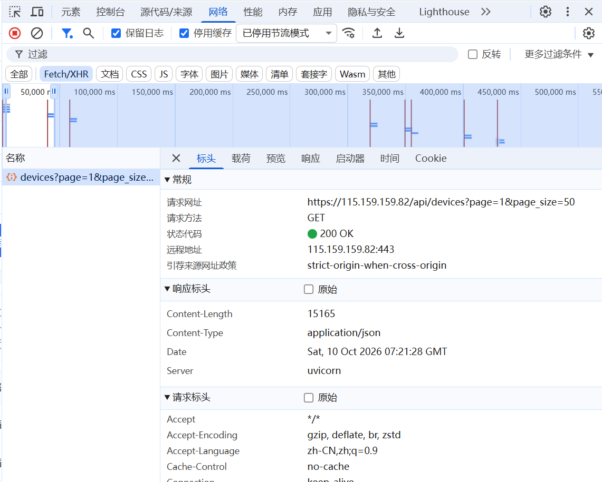
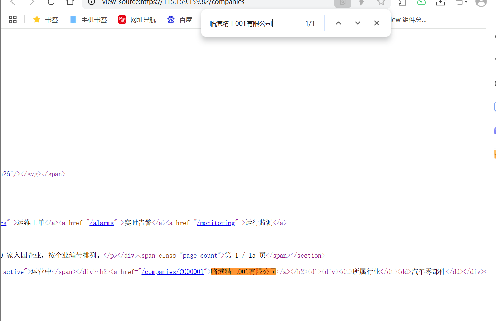
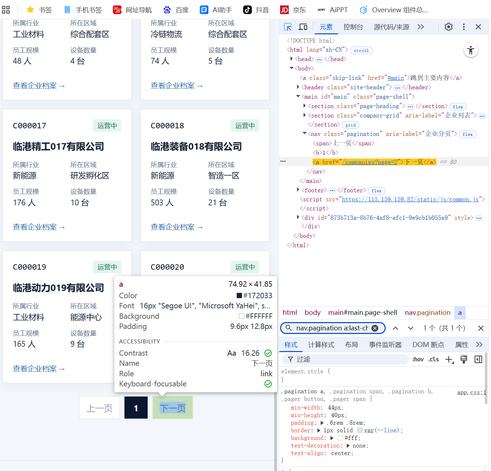
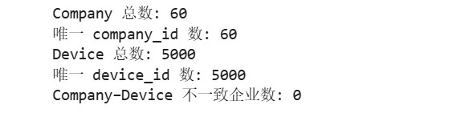

# Lab 1 实验报告

## 学生信息

- **姓名：杨素素
- **学号：112404260105
- **班级：数据1241
- **GitHub 用户名：Su-su-y
- **仓库地址：** https://github.com/Su-su-y/bigdata-collection-labs-112404260105

> 文件位置：`lab01/REPORT.md`  
> 完整代码保存在 `lab1_html_api.ipynb`。  
> 本报告只填写关键发现、关键代码、结果和指定截图，**不要把整份 Notebook 复制进来**。

> 图片加载说明：截图文件均已完整上传。如果你的网络无法访问 GitHub 图片
> CDN（`raw.githubusercontent.com`），页面内图片可能无法预览；点击截图会
> 自动打开 jsDelivr 镜像地址。

---

# 任务 1：判断数据加载方式

## 1.1 Device：判断动态加载并找到 API

### 判断结果

- 页面：`/devices`
- 数据加载方式：`动态加载`
- 判断依据：

“查看网页源代码”中没有页面最终显示的设备名称，表格初始内容为“正在加载…”，说明设备数据不是随初始 HTML 一起返回。打开 DevTools 的 Network 面板并选择 Fetch/XHR 后，可以找到 `GET /api/devices?page=1&page_size=50` 请求，响应 JSON 中包含设备列表。

### API 信息

- Request URL：`https://115.159.159.82/api/devices`
- Request Method：`GET`
- Query 参数：`page=1`、`page_size=50`

### 【截图 1】Device API 发现证据
文件名：

```text
images/01_device_api.png
```

**截图内容必须是浏览器 DevTools，不是 Jupyter 代码。**

截图中应能看清：

1. 浏览器的 **Network** 面板；
2. 已选中真正返回设备列表的 Fetch/XHR 请求；
3. 右侧 **Headers** 中的 Request URL；
4. Query String Parameters（或 URL 中的分页参数）。

> 不要截整个桌面；尽量裁剪到 Network 请求和右侧 Headers 区域。

插入：


[](https://gcore.jsdelivr.net/gh/Su-su-y/bigdata-collection-labs-112404260105@main/lab01/images/01_device_api.png)


## 1.2 Company：判断静态加载

- 页面：`/companies`
- 数据加载方式：`静态加载`
- 判断依据：

使用“右键 → 查看网页源代码”后，在源代码中可以搜索到页面真实显示的企业名称。例如，能够找到 `<h2><a href="/companies/C000001">临港精工001有限公司</a></h2>`，说明企业记录已经包含在服务器返回的 HTML 中。

### 【截图 2】Company 静态加载证据

文件名：

```text
images/02_company_source.png
```

**截图内容必须是“查看网页源代码”页面，不是 Elements，也不是 Jupyter。**

截图中应能看清：

1. 浏览器正在显示 `/companies` 的网页源代码；
2. 使用 `Ctrl + F` 搜索一个页面中真实存在的企业名称；
3. 源代码中能看到该企业名称或对应企业记录。

插入：

[](https://gcore.jsdelivr.net/gh/Su-su-y/bigdata-collection-labs-112404260105@main/lab01/images/02_company_source.png)


---

# 任务 2：Device API 分页采集

## 2.1 API 分页结构

填写你实际从 JSON 中观察到的字段：

| 含义 | JSON 字段 |
|---|---|
| 当前页 | `page` |
| 每页条数 | `page_size` |
| 设备总数 | `total` |
| 设备列表 | `items` |

## 2.2 关键代码

只填写分页采集的核心部分，不要粘贴整个 Notebook。

```python
# 从第一页响应中读取分页信息
total = data["total"]
page_size = data["page_size"]

total_pages = (total + page_size - 1) // page_size

devices = []

for page in range(1, total_pages + 1):
    r = requests.get(
        api_url,
        params={
            "page": page,
            "page_size": page_size
        },
        timeout=10,
    )

    page_data = r.json()
    page_items = page_data["items"]
    devices.extend(page_items)
```


## 2.3 采集结果

- 每页条数：`50`
- 设备总数：`5000`
- 程序计算得到的总页数：`100`
- 最终采集设备数：`5000`
- 唯一 `device_id` 数：`5000`

回答：

> 为什么总页数应由 API 返回的 `total` 和 `page_size` 计算，而不是直接在代码里写死？

答：写死页数无法适应数据总量或每页条数变化，数据减少时会请求无效页，数据增加时会漏采。根据 `total` 和 `page_size` 动态计算，可以保证分页范围与接口当前返回的数据一致。

---

# 任务 3：Company HTML 解析

## 3.1 企业记录 Selector

- 企业记录 selector：`article.company-card`
- 第 1 页企业记录数：`20`

说明为什么选择这个 selector：

- 主要使用了 `id / class / data-* / 父子层级` 中的哪一种？

主要使用了 `class`，每张企业卡片都是 `<article class="company-card">`，同时可以用记录自身的 `data-company-id` 属性读取企业编号。

- 是否参考过浏览器 Copy selector 或 AI？

可以先用浏览器 Elements 面板观察真实 DOM，但最终没有使用带多层 `nth-child(...)` 的复杂路径。

- 最终为什么采用现在这个写法？

`article.company-card` 简短且语义明确，能直接匹配所有企业记录，不依赖卡片在页面中的位置。相比复制得到的长路径，它对同级记录增删和页面结构的小改动更稳定。

## 3.2 关键代码

只填写“记录定位 + 一条记录的关键字段”。

```python
cards = soup.select("article.company-card")

card = cards[0]

company_id = card.get("data-company-id")
name = card.select_one("h2").get_text(strip=True)
status = card.select_one(".badge").get_text(strip=True)
```

行业、区域、设备数量使用 `dt/dd` 结构后，请写出你最终如何得到：

```python
details = {}

for item in card.select("dl > div"):
    key = item.select_one("dt").get_text(strip=True)
    value = item.select_one("dd").get_text(strip=True)
    details[key] = value

industry = details["所属行业"]
zone = details["所在区域"]
device_count = int(details["设备数量"].removesuffix(" 台"))
```

## 3.3 字段来源说明

任选 **2 个字段**说明：

1. 字段：`company_id`
   - 来自：`HTML 属性`
   - 使用的方法：定位 `article.company-card` 后读取 `data-company-id`，代码为 `card.get("data-company-id")`。

2. 字段：`device_count`
   - 来自：`文本`
   - 使用的方法：定位“设备数量”对应的 `dd`，使用 `get_text(strip=True)` 得到例如 `6 台`，再用 `removesuffix(" 台")` 去掉单位并转换为整数。

---

# 任务 4：Company “下一页”分页

## 4.1 下一页元素

- “下一页” selector：`nav.pagination a:last-child`
- 第 1 页 `href` 示例：`/companies?page=2`

### 【截图 3】Company “下一页”元素

文件名：

```text
images/03_company_next.png
```

**截图内容必须是浏览器 DevTools 的 Elements 面板。**

截图中应能看清：

1. 页面底部“下一页”对应的 `<a>` 元素被选中；
2. 该元素的 `class`、`href` 等关键属性；
3. 能判断你为什么使用当前 selector。

> 不需要截 Python 代码；这一张图只证明你找到了正确的 DOM 元素。

插入：


[](https://gcore.jsdelivr.net/gh/Su-su-y/bigdata-collection-labs-112404260105@main/lab01/images/03_company_next.png)


## 4.2 关键代码

```python
next_link = soup.select_one("nav.pagination a:last-child")

next_href = next_link.get("href")

next_url = urljoin(
    current_url,
    next_href
)
```

再用 2～3 句话说明：

> 你的程序如何完成“当前页 → 找下一页 href → 请求下一页 → 再解析”的循环？

答：程序先把当前 URL 指向 `/companies`，每次请求后解析本页的全部 `article.company-card` 并追加到 `companies` 列表。随后在 `nav.pagination` 中定位最后一个链接，读取“下一页”的 `href`，并用 `urljoin` 转换为完整 URL。将该 URL 赋给 `current_url` 后进行下一次请求，重复三次即可采集前 3 页。

## 4.3 三页采集结果

| 页码 | 企业数 |
|---|---:|
| 1 | 20 |
| 2 | 20 |
| 3 | 20 |
| **合计** | **60** |

- 唯一 `company_id` 数：`60`

---

# 任务 5：结果验证

## 5.1 最终结果

| 检查项 | 结果 |
|---|---:|
| Company 总数 | 60 |
| 唯一 `company_id` | 60 |
| Device 总数 | 5000 |
| 唯一 `device_id` | 5000 |
| Company–Device 不一致企业数 | 0 |

### 【截图 4】最终验证结果

文件名：

```text
images/04_validation.png
```

**截图内容必须是 JupyterLab 的运行结果，不是代码截图，也不是浏览器截图。**

截图中应能同时看清以下输出：

```text
Company 总数
唯一 company_id 数
Device 总数
唯一 device_id 数
Company–Device 不一致企业数
```

建议把这几个 `print()` 放在同一个 Notebook 单元格中运行后截图。

插入：


[](https://gcore.jsdelivr.net/gh/Su-su-y/bigdata-collection-labs-112404260105@main/lab01/images/04_validation.png)


## 5.2 一致性检查关键代码

只填写最关键的比较逻辑：

```python
from collections import Counter

device_counts = Counter(
    x["company_id"] for x in devices
)

mismatch_count = 0

for company in companies:
    cid = company["company_id"]
    expected = company["device_count"]
    actual = device_counts.get(cid, 0)

    if expected != actual:
        mismatch_count += 1
```

回答：

> 为什么 `status_code == 200` 仍然不能说明“数据已经采集正确”？

答：`200` 只表示服务器成功处理了请求，并不能证明响应中的记录数量完整、字段结构正确、分页没有遗漏或重复，也不能证明不同数据源之间彼此一致。还需要检查总数、唯一 ID、字段内容和 Company–Device 数量等业务校验结果。

---

# 任务 6：保存采集结果

确认已经生成：

```text
data/companies.json
data/devices.json
```

填写：

- `companies.json`：`已生成`
- `devices.json`：`已生成`

不需要截图 JSON 全文，也不需要把 JSON 内容复制到报告。

---

# 实验结论

用 **80～150 字**总结：

1. 静态加载与动态加载页面的处理方式有什么不同；
2. HTML “下一页”分页和 API `page` 分页有什么不同；
3. 你使用了哪些方法验证采集结果。

答：静态页面的数据直接包含在 HTML 中，可以请求页面后用 BeautifulSoup 解析；动态页面的数据由 API 返回，需要先定位请求，再解析 JSON 并构造分页参数。HTML 分页要解析“下一页”的 `href` 逐页跳转，API 分页则通过 `page` 和 `page_size` 参数循环请求。采集后我检查了总数和唯一 ID，并用公司页面中的 `device_count` 与设备数据的 `company_id` 统计值进行一致性核验，最后将结果保存为 JSON。
