# 实验二报告：房源采集与 MySQL 存储

- 班级：数据1241
- 姓名：杨素素
- 学号：112404260105
- 实验日期：2026-11-6
- GitHub 仓库链接：https://github.com/Su-su-y/bigdata-collection-labs-112404260105
- 源码文件名：`anjuke_1.ipynb`
- 数据库与表：`smartpark_lab.houseinfo`
- 数据来源：在线教学站
- 访问时间及结果：2026-11-6，默认 IPv6 入口返回 HTTP 200，但页面标题为“访问验证-安居客 ws:3703571468”，`div.property` 数量为 0；改用 IPv4 入口 `http://172.67.199.181/anjuke/` 并设置 `Host: www.bspider.top` 和浏览器 User-Agent 后正常取得房源，每页 60 条。
- 快照文件来源与文件名：不适用，本次使用在线教学站。

## 第一阶段：MySQL Docker 更新与启动

- 本次是否需要更新：已完成 L05 更新，本次直接启动现有课程 MySQL 环境，未重复更新。
- 更新或启动遇到的问题：`start-mysql.bat` 输出 `[PASS] L05 MySQL healthy，账号连接检查通过。`，未出现卷或配置异常。

### 启动环境与建表

依次使用 `start-course.bat`、`start-mysql.bat`、`mysql-console.bat` 启动课程环境、数据库和 MySQL 终端。启动脚本保护检查通过，说明 Windows 本机 MySQL 不会被操作，课程 Notebook 连接 `mysql:3306`。

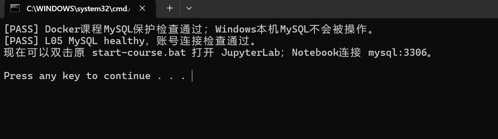

终端中执行了 `SHOW DATABASES;`、`USE smartpark_lab;`、`SHOW TABLES;`、建表语句、`DESCRIBE houseinfo;` 和入库前计数。建表前 `SHOW TABLES` 为空，建表后 `houseinfo` 包含 1 个自增 `id` 和 8 个房源字段，入库前 `before_count=0`。

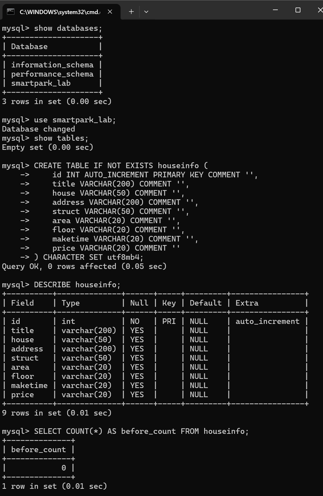

说明：当前使用的数据库是 `smartpark_lab`。`id` 是数据库自动生成的自增主键，用来唯一标识一行；其余 8 个字段依次保存标题、楼盘、地址、户型、面积、楼层、建造年代和每平方米单价。面积、楼层、年代和价格均按网页原文保存，未主动改变单位或空格格式。

## 第二阶段：房源采集与 CSV 数据存储

### 1. 网页分析与房源解析

#### 选择器是怎样得到的

- 选择的字段：房源标题
- 复制的原始选择器：Chrome 的 Copy selector 会生成包含多层 `div` 和 `:nth-child()` 的整页长路径；该路径会随房源位置变化，因此没有把它直接写入程序。
- 一条房源的父容器选择器：`div.property`
- 最终使用的相对选择器：标题 `h3.property-content-title-name`，其余字段均从当前 `row` 内部继续查找。

浏览器 Elements 面板中确认 `div.property` 刚好包住一条房源，内部同时包含标题、楼盘、地址、户型、属性列表和价格。代码先用 `soup.select("div.property")` 取得所有房源，再对每条房源使用 `row.select_one(...)`。截图任务 2-1 会在 Elements 中框出面积、楼层、年代和单价所在的 DOM 节点。
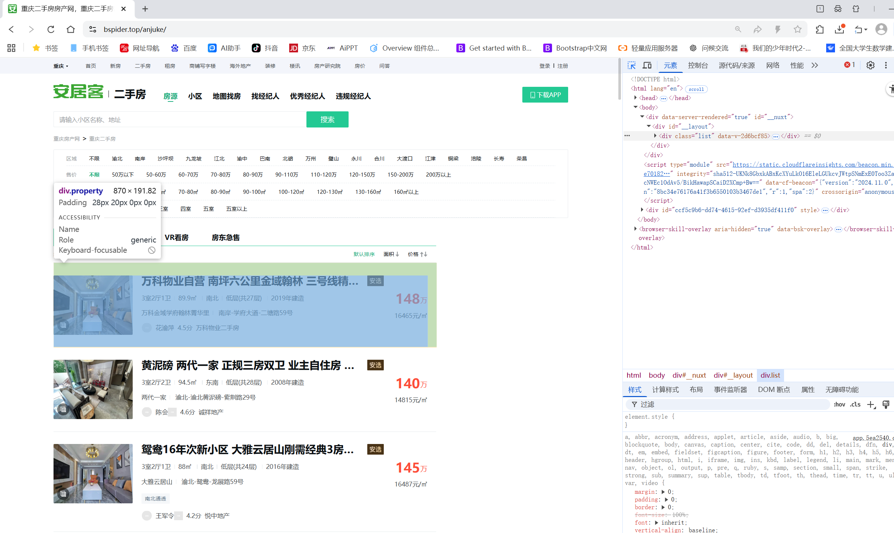


说明：删除的是从页面根节点到标题之间的外层布局和固定序号路径，保留了稳定的语义 class。父容器通过实际在线 DOM 核对，`div.property` 的数量与当前页房源数一致，因此可以确认它刚好包含一条完整房源。相对选择器只在当前房源内部查找，不会把其他房源的字段混入。

#### 解析8个字段

解析函数按 `title`、`house`、`address`、`struct`、`area`、`floor`、`maketime`、`price` 的顺序返回记录。主要选择器如下：

| 字段 | 定位方法 |
|---|---|
| title | `row.select_one("h3.property-content-title-name")` |
| house | `row.select_one("p.property-content-info-comm-name")` |
| address | `row.select_one("p.property-content-info-comm-address")`，合并地址内部的多个 `span` |
| struct | `row.select_one("p.property-content-info-attribute")` |
| 属性列表 | `row.select("div.property-content-info:not(.property-content-info-comm) > p.property-content-info-text:not(.property-content-info-attribute)")` |
| area | 从属性列表中选取以 `㎡` 结尾的文本 |
| floor | 从属性列表中选取包含“层”的文本 |
| maketime | 从属性列表中选取以“年建造”结尾的文本，找不到时写空字符串 |
| price | `row.select_one("p.property-price-average")` |

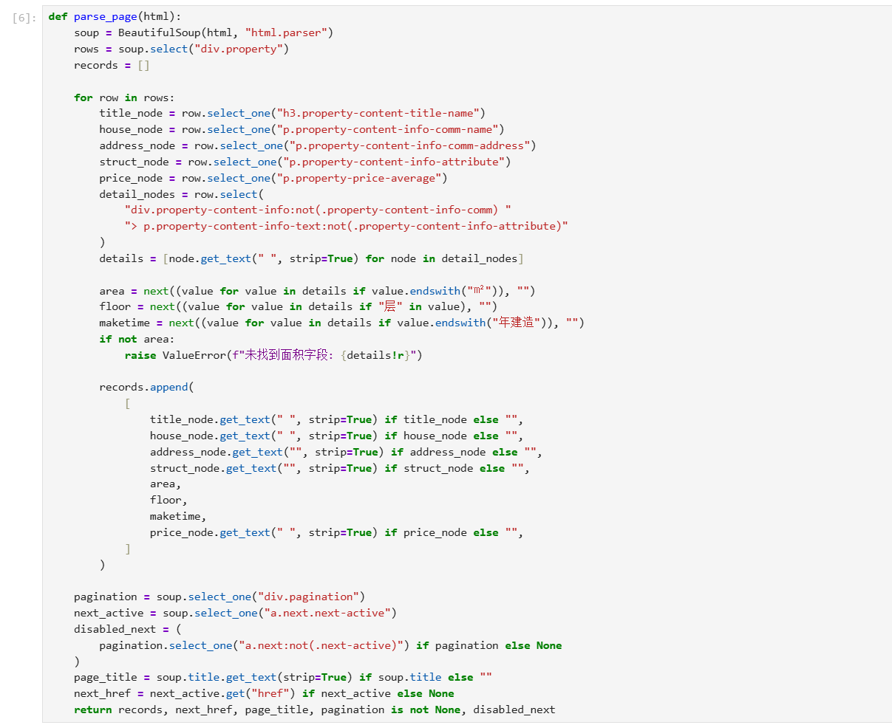

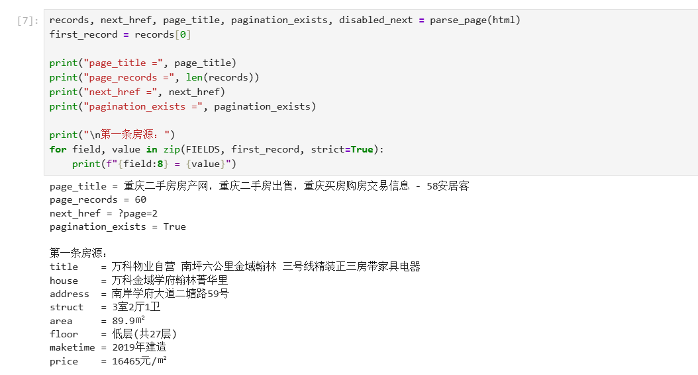

说明：`select()` 用于一次取得多条房源或多个属性项，`select_one()` 用于取得当前房源中的一个字段节点。面积按“㎡”后缀识别，楼层按“层”关键字识别，不会把“南北”等朝向误当楼层；建造年代按“年建造”识别，缺失时为空字符串。单价取自 `property-price-average`，保存的是 `16465元/㎡` 这类单价，不是 `148万` 这类总价。

首条房源实际解析结果为：

```text
万科物业自营 南坪六公里金域翰林 三号线精装正三房带家具电器
万科金域学府翰林菁华里
南岸学府大道二塘路59号
3室2厅1卫
89.9㎡
低层(共27层)
2019年建造
16465元/㎡
```

### 2. 下一页采集

- 下一页 `href` 原值：`?page=2`
- 用 `urljoin()` 补全后的地址：`http://www.bspider.top/anjuke/?page=2`
- 实际停止原因：第 10 页的 `div.pagination` 仍然存在，上一页节点是活动的 `a.pre.pre-active`，下一页节点变为 `<a class="next" href="#">下一页</a>`，已没有 `next-active` 且 `href` 为 `#`，确认按钮已禁用；`next_href` 为 `None`，程序执行 `break` 正常停止。

分页循环使用 `visited` 集合记录访问过的地址，先检查当前地址是否重复，再用 `urljoin(current_url, next_href)` 补全下一页。补全后会检查目标站点的 `netloc` 仍为教学站，并检查下一页地址没有访问过；每次请求后至少等待 1 秒。安全上限为 20 页，若达到上限会抛出“达到安全页数上限，采集中止”，不会把异常当成采集完成。
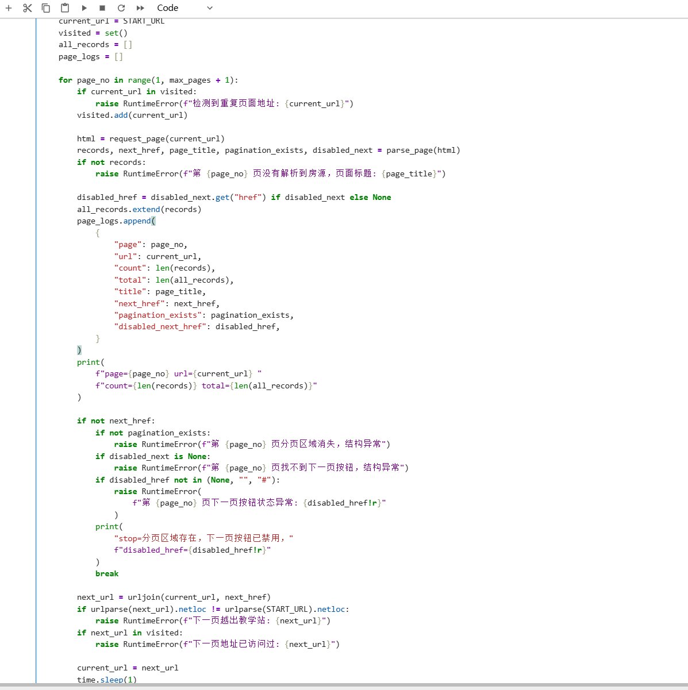

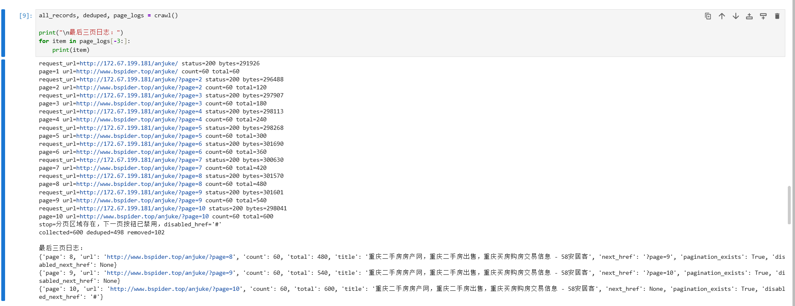

说明：第 1 页的 `?page=2` 补全后实际打开第 2 页，第 2 页又给出 `?page=3`，说明地址更新有效。第 10 页的日志中 `next_href` 为 `null`，对应代码的 `if not next_href` 停止分支。随后重新检查了第 10 页 DOM：分页区域没有消失，`a.pre.pre-active` 仍能返回第 9 页，而下一页按钮为 `<a class="next" href="#">`，只缺少 `next-active`，因此属于按钮禁用而不是结构异常。`visited`、同站检查和页数上限共同防止重复采集和无限循环；若请求失败、页面无房源或地址重复，程序会报错而不是继续伪造结果。

#### 在线访问异常及处理

默认入口虽然返回 HTTP 200，但正文是“访问验证-安居客”，`div.property` 数量为 0，属于验证页而不是房源列表。为避免把验证页写入 CSV，程序先停止解析，并改用同一教学站的 IPv4 解析地址发起请求，同时保留 `Host: www.bspider.top` 和浏览器 User-Agent。处理后可稳定取得 10 页房源，没有改采真实安居客网站。

### 3. 保存 CSV

CSV 使用 `utf-8-sig` 编码、`newline=""` 和 `csv.writer` 写入。表头和数据顺序固定为：

```text
title, house, address, struct, area, floor, maketime, price
```

全部 600 条记录按 8 个字段组成的元组去重：`key = tuple(record)`，仅当 `key not in seen` 时加入 `deduped`。因此只删除 8 个字段完全相同的记录，不会因为标题相同但地址或价格不同而误删。
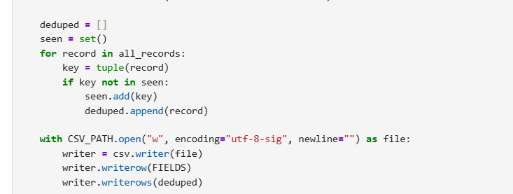

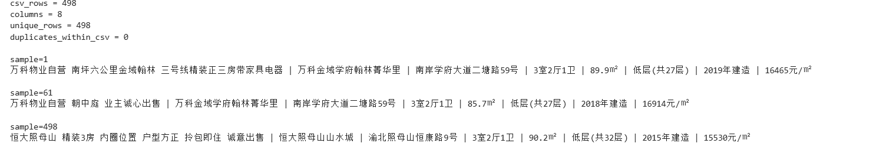


说明：本次共采集 10 页、600 条记录，按 8 字段完全去重时删除 102 条，最终保存 498 条。再次用 `csv.DictReader` 回读得到 498 行，表头正好是 8 个规定字段；CSV 内部没有重复行。样本 1、跨页样本 61 和最后一条样本 498 均逐字段对照过网页。

三条 CSV 核对样本为：

```text
sample=1
万科物业自营 南坪六公里金域翰林 三号线精装正三房带家具电器 | 万科金域学府翰林菁华里 | 南岸学府大道二塘路59号 | 3室2厅1卫 | 89.9㎡ | 低层(共27层) | 2019年建造 | 16465元/㎡

sample=61
万科物业自营 朝中庭 业主诚心出售 | 万科金域学府翰林菁华里 | 南岸学府大道二塘路59号 | 3室2厅1卫 | 85.7㎡ | 低层(共27层) | 2018年建造 | 16914元/㎡

sample=498
恒大照母山 精装3房 内圈位置 户型方正 拎包即住 诚意出售 | 恒大照母山山水城 | 渝北照母山恒康路9号 | 3室2厅1卫 | 90.2㎡ | 低层(共32层) | 2015年建造 | 15530元/㎡
```

## 第三阶段：MySQL 数据存储

### 1. 读取 CSV 并入库

本阶段只读取第二阶段的 `data/houseinfo.csv`，不重新爬取网页。`csv.DictReader` 先检查表头是否严格等于 `FIELDS`，再按固定顺序把每行整理成 8 个值。INSERT 语句中的 8 个 `%s` 依次对应：

```text
title, house, address, struct, area, floor, maketime, price
```

数据库连接使用课程统一参数，`autocommit=False`，由程序显式提交或回滚。入库前先读取现有 8 字段记录并构造集合 `existing`，只把不在集合中的行放入 `missing`，再执行 `executemany()`。这样重复运行不会依赖自增 `id`，也不需要清空表。
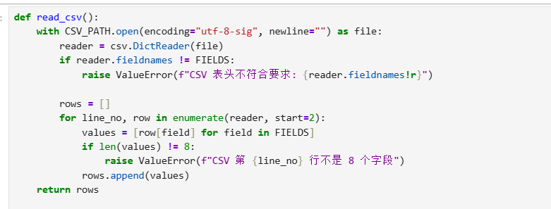

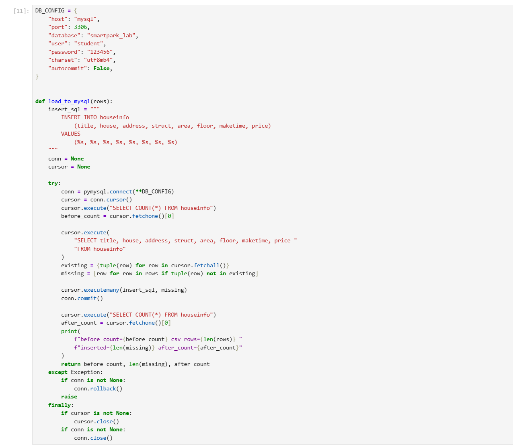

说明：CSV 值在 `execute`/`executemany` 中通过参数占位符传入，没有使用字符串拼接。写入成功后调用 `commit()`；发生异常时在 `except` 中调用 `rollback()`，并在 `finally` 中先关闭游标、再关闭连接。再次运行时，已有 8 字段元组会命中 `existing`，`missing` 为空，所以新增条数为 0。

### 2. 核对结果
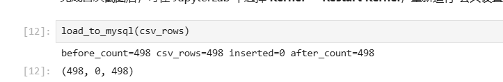

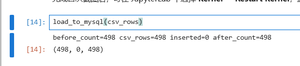

说明：首次插入已在本次截图前完成，Docker 数据卷保留了已有的 498 条数据，因此本次会话第一次执行时已经显示 `before_count=498`、`inserted=0`、`after_count=498`。重启内核后再次运行同一批代码，结果仍为 498、新增 0、498。建表时 `before_count=0` 的证据见第一阶段的 `work-result.png`；首次从 0 增加到 498 的单次输出未单独保留截图。三条样本均返回 `matched=True`，证明重复运行没有插入重复记录。
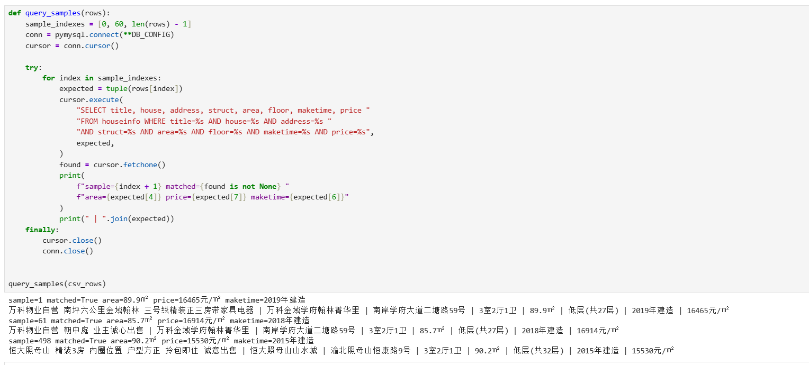

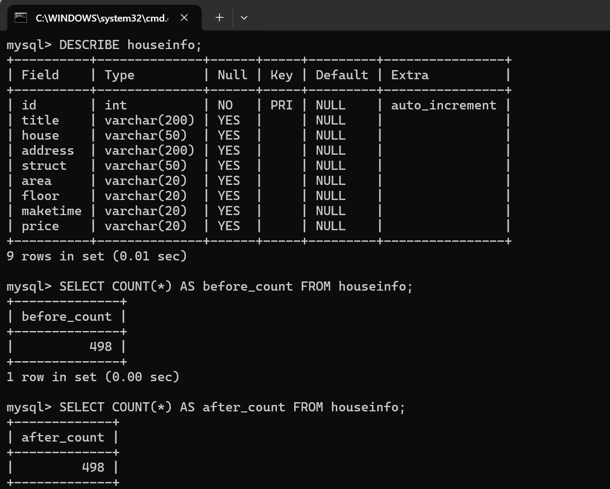
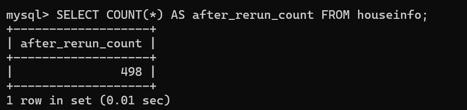
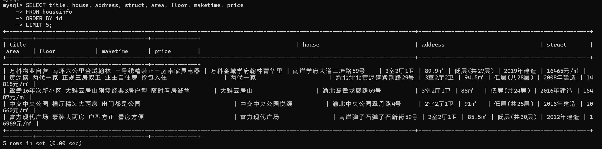

| 项目 | 实际结果 |
|---|---|
| 成功采集页数 | 10 页 |
| 采集记录数（去重前） | 600 条 |
| 完全相同的重复记录数 | 102 条 |
| CSV数据行数（不含表头） | 498 行，8 列 |
| 建表时条数 | 0 |
| 数据库当前条数 | 498 |
| 本次会话首次执行前条数 / 新增条数 | 498 / 0 |
| 重启内核后，同批数据独立重跑前条数 / 新增条数 / 重跑后条数 | 498 / 0 / 498 |
| 首次入库输出截图 | 未单独保留；建表时 0 条见第一阶段，当前 498 条见查询截图 |
| 是否采集完整；未完成的原因 | 完整；第10页分页区域存在，下一页按钮已禁用（缺少 `next-active` 且 `href="#"`），程序正常停止，无未完成步骤 |

说明：去重后 CSV 为 498 行，数据库当前也为 498 条，二者一致。由于首次插入已在本次截图前完成，本次可见的两次执行均新增 0 条。8 个字段的文字、单位、顺序和空白均按 CSV 原样写入；数据库只额外生成自增 `id`。重启内核后总数不变，说明“比较已有 8 字段记录后只插入缺失记录”的策略有效。

#### 逐条核对

- 样本1（第1页第1条，CSV第1行）：`万科物业自营 南坪六公里金域翰林 三号线精装正三房带家具电器 | 万科金域学府翰林菁华里 | 南岸学府大道二塘路59号 | 3室2厅1卫 | 89.9㎡ | 低层(共27层) | 2019年建造 | 16465元/㎡`
- 样本2（第2页第1条，CSV第61行）：`万科物业自营 朝中庭 业主诚心出售 | 万科金域学府翰林菁华里 | 南岸学府大道二塘路59号 | 3室2厅1卫 | 85.7㎡ | 低层(共27层) | 2018年建造 | 16914元/㎡`
- 样本3（最后一条，CSV第498行）：`恒大照母山 精装3房 内圈位置 户型方正 拎包即住 诚意出售 | 恒大照母山山水城 | 渝北照母山恒康路9号 | 3室2厅1卫 | 90.2㎡ | 低层(共32层) | 2015年建造 | 15530元/㎡`

核对结论及差异：三条样本的网页文本、CSV 内容和数据库查询结果逐字段一致，没有发现差异。面积均保留 `㎡`，价格均为 `元/㎡` 单价，年代均保留“年建造”，楼层没有误取朝向。

## 问题与解决

- 遇到的问题、处理方法及结果：默认 IPv6 教学站入口返回访问验证页，虽然状态码为 200，但 `div.property` 为 0。程序没有继续写入验证页，而是改用 IPv4 入口并设置正确的 `Host` 和浏览器 User-Agent，随后成功采集 10 页；若仍失败，程序会按异常终止。
## 思考题

1. 本次怎样实现下一页采集？结合自己的代码说明。

   答：先从当前页的 `a.next.next-active` 读取 `href="?page=2"`，再用 `urljoin(current_url, next_href)` 补全为 `http://www.bspider.top/anjuke/?page=2`。循环中先检查 `visited` 防止重复地址，再检查 `urlparse(next_url).netloc` 没有越出教学站，最后把 `current_url` 更新为下一页并等待 1 秒。第 10 页的 `div.pagination` 仍存在，上一页按钮仍有效，下一页按钮变为 `<a class="next" href="#">`，缺少 `next-active`，所以 `next_href` 为 `None`，执行 `break` 正常结束；如果达到 20 页上限则报错中止，不把达到上限当作完成。

2. 旧代码把 out_list 定义在全局。你把结果列表放在哪里？为什么？

   答：我把 `visited`、`all_records` 和 `page_logs` 都放在 `crawl()` 函数内部，并在结束时返回采集结果和日志。这样每次调用都有独立状态，避免重复运行或测试时残留上一轮数据，也减少模块之间的隐式依赖；分页、去重和保存都可以用同一组局部变量完成。

3. 你怎样获取建造年代？节点缺失或顺序改变时，怎样处理？

   答：先从当前房源的属性列表 `details` 中选取以“年建造”结尾的文本，而不是固定读取 `details[3]`。因此某个朝向或其他属性缺失、属性顺序改变时仍能定位年代；找不到年代时 `next(..., "")` 返回空字符串并按空值保存。面积和楼层也分别按“㎡”和“层”关键字识别，面积完全缺失时主动报错，避免把错误数据继续写入 CSV。

